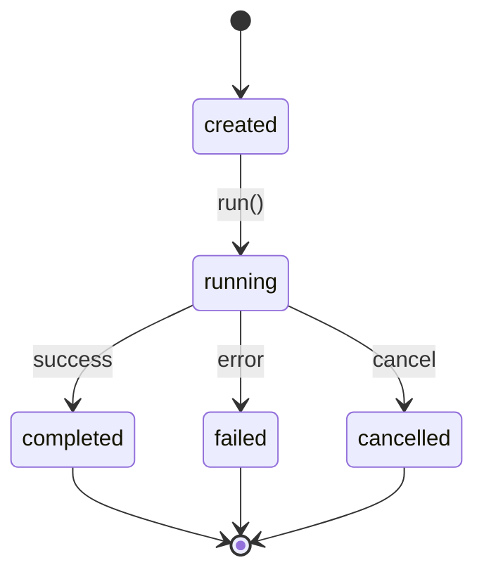

# Agents

An agent is a **goal-oriented worker**, not a model. It receives a task, reasons
about it (through the model router), acts on the world (through the tool
runtime), and reports an outcome. It never gets unrestricted OS access and never
talks to a model provider directly.

Code: `server/app/agents/`.

## The contract

`Agent` (`base.py`) is an ABC. Every concrete agent declares three things, and
`__init_subclass__` rejects any subclass that forgets one:

| Declaration | Purpose |
|---|---|
| `agent_type` | Stable identity (e.g. `coding.agent`). What the registry and router key on. |
| `description` | What the agent is for. |
| `run(...)` | The actual work, implemented concretely. |

`agent_type` and `description` are `ClassVar` declarations — they describe the
*type*, not an instance. The Core never hard-codes the list of types (§40);
concrete agents declare themselves and the registry discovers them.

## Registry and manager

- **`AgentRegistry`** (`registry.py`) — holds the type → class map.
  `register` refuses a non-`Agent` class and an abstract class, and rejects a
  duplicate `agent_type` with `ConflictError` (409). `lookup` resolves a type or
  raises `AgentTypeNotFoundError`. `create(agent_type, **kwargs)` is the
  type-level "create agents" operation.
- **`AgentManager`** (`manager.py`) — instance lifecycle and concurrency. It
  enforces `AGENT_MAX_CONCURRENCY` and `AGENT_MAX_PER_TYPE`, tracks status, and
  publishes lifecycle events.
- **`loop.py`** — the agent reasoning/acting loop.

## Registered agent types

| Type | Class | Purpose |
|---|---|---|
| `coding.agent` | `CodingAgent` | Implements changes in an isolated workspace via the OpenCode engine. |
| `research.agent` | `ResearchAgent` | Research with artifacts and a written report. |
| `browser.agent` | `BrowserAgent` | Drives Playwright through the browser tools. |
| `computer.agent` | `ComputerAgent` | Operates a Windows computer node via the gateway. |
| `iot.agent` | `IoTAgent` | Interacts with ESP32 / IoT devices. |
| `mock.agent`, `mock.failing`, `mock.long_running` | `mock/` | Deterministic agents for tests. |

## Lifecycle

Terminal states are `completed`, `failed`, `cancelled`. A heartbeat
(`AGENT_HEARTBEAT_INTERVAL`) marks liveness while running.

## Permissions and memory

- Every agent is created with a permission ceiling
  (`AGENT_DEFAULT_PERMISSION_LEVEL`, 0–5). Tool calls above the ceiling are
  denied by the Permission Manager; level `AGENT_CONFIRMATION_LEVEL` requires
  explicit human confirmation. See [`security.md`](security.md).
- Each agent works in a memory namespace (`AGENT_MEMORY_NAMESPACE` prefix). See
  [`memory.md`](memory.md).

## Configuration

| Variable | Effect |
|---|---|
| `AGENT_DEFAULT_TIMEOUT` | Default agent timeout. |
| `AGENT_MAX_CONCURRENCY` | Global concurrency cap (resource-aware). |
| `AGENT_MAX_PER_TYPE` | Per-type cap. |
| `AGENT_HEARTBEAT_INTERVAL` | Liveness heartbeat. |
| `AGENT_DEFAULT_PERMISSION_LEVEL` | Default ceiling. |
| `AGENT_CONFIRMATION_LEVEL` | Level needing human confirmation. |
| `AGENT_MAX_LOG_LINES` | Log output cap. |
| `AGENT_MEMORY_NAMESPACE` | Memory namespace prefix. |

See [`configuration.md`](configuration.md) for the full list.

## Hard rules

1. Agents cannot bypass the Core's permission and event systems.
2. An agent never names a model provider; it asks the router.
3. A provider type never leaks into an agent.
4. `agent_type` is a declaration, never hard-coded into the Core.
