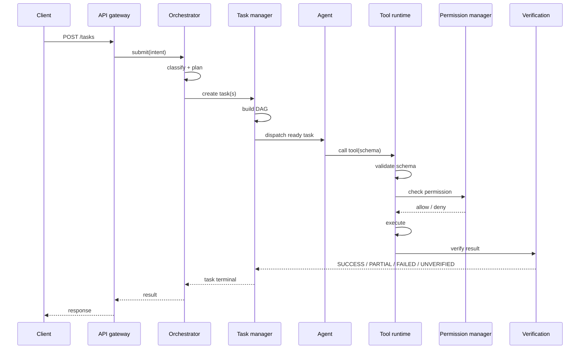
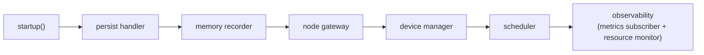

# ULTRON architecture

ULTRON is an orchestration platform *around* models. It coordinates models,
agents, tools, tasks, memory, nodes, voice, devices and schedules, and it never
lets any one of those become the system. This document describes the layers as
they are actually implemented under `server/app/`, and the rules that keep them
separated.

> The UI never becomes the brain, and the LLM never becomes the operating system.

## Layer map

```mermaid
flowchart TB
    subgraph clients["Client / physical layer"]
        orb["ULTRON Orb"]
        console["Command console (Electron / PWA)"]
        win["Windows node"]
        esp["ESP32 device"]
    end

    subgraph api["API gateway (app/api)"]
        rest["REST routes"]
        wsapi["/ws event stream"]
        deps["dependencies.py (DI + auth)"]
    end

    subgraph core["ULTRON Core (app/core)"]
        orch["Orchestrator"]
        router["Intent router"]
        planner["Planner"]
        ctx["Context manager"]
        perms["Permission manager"]
        executor["Executor"]
    end

    subgraph agents["Agents (app/agents)"]
        registry["Registry"]
        manager["Manager"]
        loop["Agent loop"]
    end

    subgraph tasks["Tasks (app/tasks)"]
        tmgr["Task manager"]
        graph["Task DAG"]
        texec["Task executor"]
    end

    subgraph intel["Intelligence (app/models)"]
        mrouter["Model router"]
        ollama["Ollama adapter"]
        fake["Fake adapter"]
        cloud["OpenAI / Gemini / Anthropic"]
    end

    subgraph exec["Execution (app/tools, app/workspaces)"]
        tr["Tool runtime"]
        browser["Browser"]
        terminal["Terminal / Git / Files"]
        workspaces["Workspaces"]
    end

    subgraph infra["Infrastructure"]
        bus["Event bus (app/events)"]
        mem["Memory (app/memory)"]
        ver["Verification (app/verification)"]
        pg[("PostgreSQL + pgvector")]
        redis[("Redis")]
        sched["Scheduler (app/scheduler)"]
        obs["Observability (app/observability)"]
    end

    clients --> api
    api --> core
    core --> agents
    core --> tasks
    agents --> mrouter
    mrouter --> ollama
    mrouter --> fake
    mrouter --> cloud
    tasks --> tr
    tr --> browser
    tr --> terminal
    tr --> workspaces
    tr --> perms
    tr --> ver
    agents --> mem
    mem --> pg
    bus --> redis
    sched --> tasks
    bus --> wsapi
    obs -.reads.-> bus
```

## Request path

A request enters through the API gateway, is classified by the **intent router**,
planned, and turned into tasks by the **orchestrator**. Tasks are decomposed into
a **DAG** and executed by agents. Every agent step that touches the world goes
through the **tool runtime**, which enforces the same gate for every tool:



## Process lifecycle

There is exactly one process: the API. Everything is started *inside* it by
`Container.startup()` (`server/app/container.py`) in a fixed order, so a
component can assume the things above it exist:



There is **no separate worker process**. This is deliberate and is why
`deployment/systemd/` ships a single `ultron-api.service`.

## Component map

| Layer | Package | Responsibility |
|---|---|---|
| API | `app/api/routes/` | One module per surface: auth, health, events, agents, tasks, tools, chat, nodes, devices, voice, schedules, notifications. Mounted explicitly in `main.py::_include_routers`. |
| API | `app/api/dependencies.py` | Request dependencies: container access and authentication. |
| Core | `app/core/` | `orchestrator`, `router` (intent), `planner`, `context`, `permissions`, `executor`, `errors`. |
| Agents | `app/agents/` | `base` (the goal-oriented worker), `loop`, `manager`, `registry`. |
| Tasks | `app/tasks/` | `graph` (DAG), `state`, `manager`, `executor`. |
| Models | `app/models/` | `base` (adapter protocol), `ollama`, `fake`, `openai`, `gemini`, `anthropic`, and `router`. |
| Tools | `app/tools/` | `base`, `registry`, `arguments`, `executor`, `bootstrap`. |
| Memory | `app/memory/` | `short_term`, `long_term`, `episodic`, `semantic`, `project`, `embeddings`, `namespaces`, `recorder`, `manager`, `types`. |
| Verification | `app/verification/` | Outcome decision: `SUCCESS`, `PARTIAL`, `FAILED`, `UNVERIFIED`. |
| Events | `app/events/` | `bus` (publish/subscribe, SSE resumption), `types` (`EventType`), `handlers`. |
| Workspaces | `app/workspaces/` | Isolated git workspaces for coding agents. |
| Voice | `app/voice/` | `manager`, `responder`, `fallback`. |
| Devices | `app/devices/` | `manager`, `protocol`, `store` (ESP32 / IoT). |
| Scheduler | `app/scheduler/` | `manager`, `automation`, `planning`, `triggers`, `workflows`. |
| Notifications | `app/notifications/` | `service`, `dispatch`, `base`, `log`, `webhook`. |
| Security | `app/security/` | `authentication`, `tokens`, `passwords`, `permissions`, `audit`. |
| Database | `app/database/` | `session` (async PostgreSQL), `redis_client`. |
| Observability | `app/observability/` | `logging`, `health`, `metrics`, `monitoring`, `resources`. |
| Composition | `app/container.py`, `app/main.py` | Hand-rolled DI container and the FastAPI app factory. |

## Non-negotiable rules

These are the constraints the layering enforces; a change that violates one is a
bug, not a design choice.

1. **Core is never coupled to a single model provider.** Everything reaches a
   model through an adapter in `app/models/` behind `app/models/router.py`.
2. **No unrestricted OS access.** Every tool call passes schema validation →
   permission check → policy check → execution → verification.
3. **No agent framework is the foundation.** `app/agents/base.py` defines the
   worker contract; frameworks are not load-bearing.
4. **Agents cannot bypass Core.** Permissions and events are enforced by the
   Core, not the agent.
5. **Success is never assumed.** Verification decides the outcome among
   `SUCCESS`, `PARTIAL`, `FAILED`, `UNVERIFIED`.
6. **PostgreSQL is authoritative.** Redis holds only temporary state (cache,
   queues, pub/sub, locks).
7. **Nothing is faked.** An unavailable subsystem reports unavailable.

## Data stores

- **PostgreSQL** (with `pgvector`) — tasks, agents, users, events, memory,
  schedules, devices. The source of truth.
- **Redis** — event fan-out, distributed locks, transient queues. Never backed
  up, because restoring it can resurrect a lock for a task that no longer exists.

See [`api.md`](api.md) for the HTTP surface, [`configuration.md`](configuration.md)
for every setting, and [`deployment.md`](deployment.md) for how this runs in
production.
