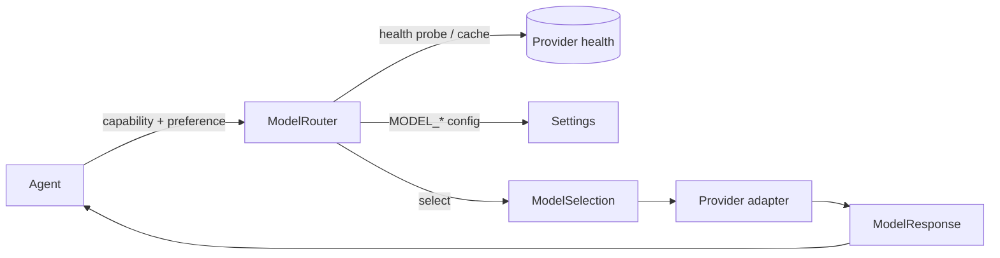

# Models

ULTRON treats models as interchangeable adapters behind one interface. Agents
never name a provider; they ask the **model router** for a model that fits the
task, and the router returns a provider-neutral selection. This is the layering
rule (§40) applied to models: a provider is an adapter to a model, not the model
itself.

Code: `server/app/models/`.

## Provider adapters

| Module | Provider | Notes |
|---|---|---|
| `ollama.py` | Ollama | Local or hosted; the only local model path. |
| `openai.py` | OpenAI | Requires `OPENAI_API_KEY`. |
| `gemini.py` | Gemini | Requires `GEMINI_API_KEY`. |
| `anthropic.py` | Anthropic | Requires `ANTHROPIC_API_KEY`. |
| `fake.py` | Fake | Deterministic provider for tests. |

Every adapter implements `ModelProvider` (`base.py`):

- `chat(request) -> ModelResponse`
- `stream(request) -> AsyncIterator[ModelStreamChunk]`
- provider identity and health/status reporting

Streaming **degrades gracefully**: a provider without native streaming returns a
single-chunk stream built from `chat`, so it is still a complete provider.

The provider boundary speaks only the provider-neutral `ModelRequest` /
`ModelResponse` / `ModelStreamChunk` vocabulary. A provider type never appears in
a response, and never leaks into an agent.

## Capabilities

`ModelCapability` is the set of task shapes the router can resolve:

| Capability | Configuration key |
|---|---|
| `fast` | `MODEL_FAST` |
| `coding` | `MODEL_CODING` |
| `research` | `MODEL_RESEARCH` |
| `vision` | `MODEL_VISION` |
| `reasoning` | `MODEL_REASONING` |

If a capability is unconfigured, it degrades to `MODEL_DEFAULT`.

## Router

`ModelRouter` (`router.py`) selects a `provider:model` for a request. Its inputs
(§49):

- **Task type / capability** — resolves to the configured identifier.
- **Latency / quality preference** (`speed` of `"fast"` or `"quality"`).
- **Availability** — a candidate whose provider is unconfigured is skipped.
- **Provider health** — probes providers with a TTL cache
  (`MODEL_HEALTH_REFRESH`); an unhealthy provider is temporarily
  circuit-broken.
- **Fallback chain** — `MODEL_FALLBACK_CHAIN`, ordered, used when the selected
  provider is unavailable.
- **Resource usage** — an optional resource guard and per-provider limits.

Selection returns a `ModelSelection` with `provider` (provider key) and `model`
(the **bare** model id with the `<provider>:` prefix stripped). The router is the
only caller of `ModelProvider` below an agent.



## Identifiers

Configuration uses `provider:model`:

```
MODEL_DEFAULT=ollama:qwen2.5:7b-instruct
MODEL_CODING=ollama:qwen2.5-coder:7b
```

The provider receives only the bare model id. No model name is hard-coded in the
application; all selection is configuration.

## Health and usage

- `MODEL_HEALTH_REFRESH` controls how often provider availability is re-probed.
- `OLLAMA_HEALTHCHECK` reports Ollama health through `/health` and `/ready`.
- `MODEL_USAGE_TRACKING` records token usage and latency; the observability
  subsystem also exposes request/token/latency metrics (see Phase 12).
- `MODEL_MAX_RETRIES` and `MODEL_RETRY_BACKOFF` govern transient errors.

## Configuration

| Variable | Effect |
|---|---|
| `MODEL_DEFAULT` | Fallback model for every capability. |
| `MODEL_CODING`, `MODEL_RESEARCH`, `MODEL_VISION`, `MODEL_FAST`, `MODEL_REASONING` | Per-capability models. |
| `MODEL_FALLBACK_CHAIN` | Ordered fallback list. |
| `MODEL_MAX_OUTPUT_TOKENS`, `MODEL_TEMPERATURE` | Generation parameters. |
| `MODEL_REQUEST_TIMEOUT` | Per-request timeout. |
| `MODEL_MAX_RETRIES`, `MODEL_RETRY_BACKOFF` | Retry policy. |
| `MODEL_USAGE_TRACKING` | Token/latency recording. |
| `MODEL_HEALTH_REFRESH` | Health probe interval. |
| `OLLAMA_*` | Ollama connection and behaviour. |
| `OPENAI_*`, `GEMINI_*`, `ANTHROPIC_*` | Cloud provider configuration. |

See [`configuration.md`](configuration.md) for every variable.

## Hard rules

1. Core never depends on one provider.
2. Agents never name a provider or a model.
3. A provider type never leaks past the router.
4. The system must boot with all cloud providers empty and function with only
   Ollama configured.
