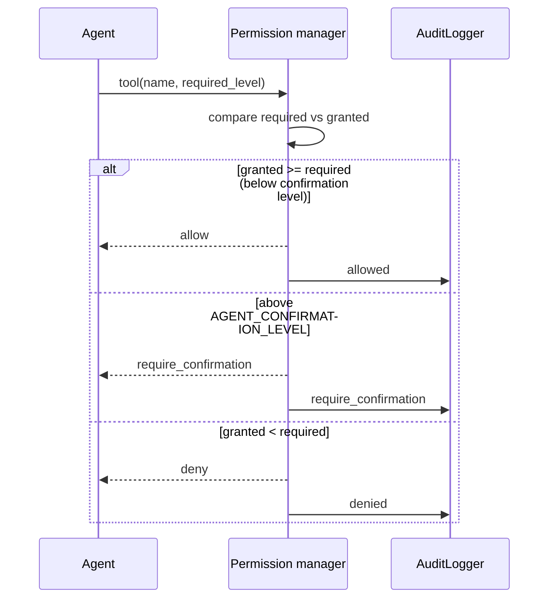

# Security

Security in ULTRON is a **layered gate**, not a switch. Every tool call passes
schema validation → permission check → policy check → execution → verification,
and every decision is written to the audit log.

Code: `server/app/security/`, `server/app/database/models/`.

## Permission levels (§15)

`PermissionLevel` is the only permission scale. A level implies every level below
it, so `allows` is a comparison, not a table lookup:

| Level | Member | Meaning |
|---|---|---|
| 0 | `READ_ONLY` | Read only. |
| 1 | `SAFE_ACTIONS` | Safe actions. |
| 2 | `MODIFY_PROJECT` | Modify project files. |
| 3 | `EXECUTE_PROGRAMS` | Execute programs. |
| 4 | `SYSTEM_CONFIG` | System configuration. |
| 5 | `DESTRUCTIVE` | Destructive operations. |

A tool declares the `required_level` it needs. A principal has a `granted_level`
ceiling. The decision is `allow`, `deny`, or `require_confirmation`:

`AGENT_DEFAULT_PERMISSION_LEVEL` sets the ceiling for new agents; any level at or
above `AGENT_CONFIRMATION_LEVEL` needs an explicit human `confirmed` flag.

## Audit logging

`AuditLogger` (`audit.py`) records every decision — `allowed`, `denied`,
`require_confirmation` — with actor, action, resource and outcome
(`AuditOutcome`). It implements an `AuditSink` so the sink can be replaced.
Retention is `AUDIT_LOG_RETENTION_DAYS` (default 180).

## Authentication

- **`Authenticator`** (`authentication.py`) — issues and validates principals.
  A `Principal` knows `actor_id` and whether it `is_machine` (device/node tokens).
- **JWT access + refresh tokens** — `JWT_SECRET` signs; `JWT_ALGORITHM`,
  `ACCESS_TOKEN_EXPIRE_MINUTES`, `REFRESH_TOKEN_EXPIRE_DAYS` control lifetimes.
  `tokens.py` handles generation, expiry, Bearer extraction and API-key digests.
  Revocation can cascade across a token family (`RevokeFamily`).
- **Passwords** — Argon2 (`passwords.py`) with `ARGON2_TIME_COST`,
  `ARGON2_MEMORY_COST`, `ARGON2_PARALLELISM`.
- **`ALLOW_ANONYMOUS=false`** is required in production; enabling it opens the
  REST and WebSocket API without a token.

## Guard rails

| Guard | Setting | Effect |
|---|---|---|
| Shell allow-list | `TERMINAL_ALLOWED_COMMANDS` | Empty denies all shell execution. |
| Shell deny-list | `TERMINAL_DENIED_PATTERNS` | Prefixes (`rm -rf /`, `mkfs`, …) never allowed, even if allow-listed. |
| SSRF | `WEB_ALLOW_PRIVATE_NETWORKS` | Keeps `web.*` off internal addresses. |
| Rate limit | `RATE_LIMIT_ENABLED`, `RATE_LIMIT_REQUESTS` | Per-principal requests/minute. |
| CORS | `CORS_ORIGINS` | Trusted origins only; `*` disables credentialed requests. |
| Host header | `ALLOWED_HOSTS` | Host-header allow-list (set in production). |
| Secrets | — | In `.env`, `chmod 600`, never in git. |

## Production hardening (spec §31)

- PostgreSQL, Redis and Ollama bind `127.0.0.1` / private interface.
- The service runs as a non-root user under systemd with `NoNewPrivileges`,
  `ProtectSystem=strict`, `ProtectHome=read-only`, `PrivateTmp`,
  `RestrictAddressFamilies`, a `SystemCallFilter`, and three `ReadWritePaths`.
- A reverse proxy terminates TLS; ULTRON binds `127.0.0.1`.
- `/metrics` is unauthenticated by design, so it must be restricted at the
  proxy or firewall, never relied on to be private.
- Generate `JWT_SECRET` and set a real `ADMIN_PASSWORD`.

See [`deployment.md`](deployment.md) and `deployment/README.md` for the enforced
config, and [`configuration.md`](configuration.md) for every setting.

## Hard rules

1. An LLM never receives unrestricted OS access.
2. Agents cannot bypass the Core's permission and event systems.
3. Every permission decision is auditable.
4. No secret is committed.
5. Nothing that is unavailable is reported as available.
