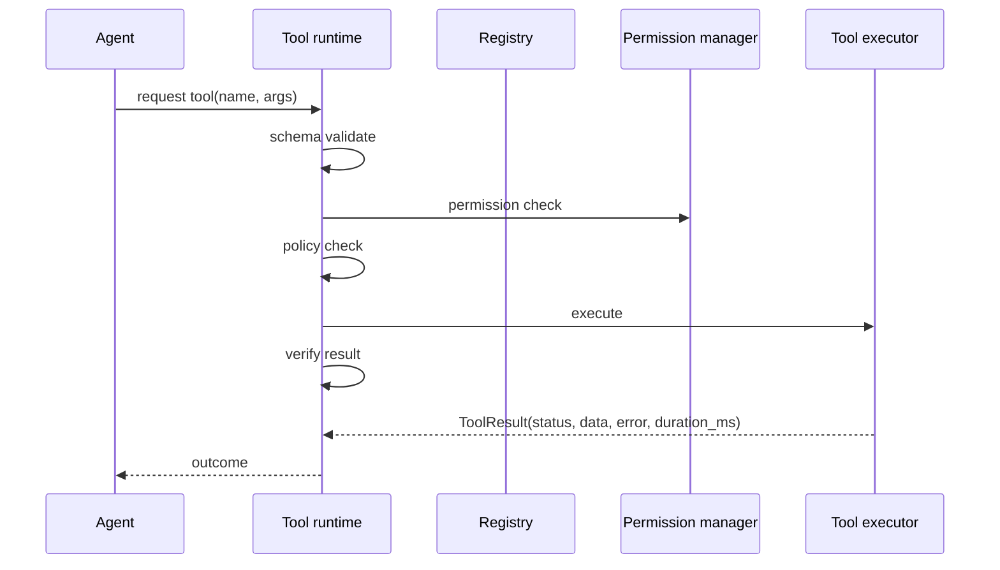

# Tools

Tools are the only way agents affect the world. Every tool call goes through the
**tool runtime**, which enforces: schema validation → permission check →
policy check → execution → verification.

Code: `server/app/tools/`.

## The tool contract

`Tool` (`base.py`) requires declarations at class definition time. The base
class rejects a subclass that fails to declare:

- `name` — unique, namespaced (e.g. `filesystem.read`, `terminal.run`)
- `description` — what the tool does
- `parameters` — JSON-schema for inputs
- `returns` — JSON-schema for outputs

The registry and executor rely on those. A tool cannot be half-declared.

## Registry and executor

- **`ToolRegistry`** (`registry.py`) — keeps name → `Tool` and validates
  duplicates; `__init_subclass__` already failed tools with bad declarations, so
  registration cannot reach an ill-formed tool. It can also return a tool by
  name.
- **`ToolExecutor`** (`executor.py`) — executes a named tool with args; it
  returns a `ToolResult` containing `status`, `data`, `error` and
  `duration_ms`. Validation, permission, policy and verification are applied by
  the Core / runtime boundary before/after this call.
- **`arguments.py`** — argument helpers/schema handling.
- **`bootstrap.py`** — builds the full inventory of default tools at startup and
  registers them. The browser family is only included when `BROWSER_ENABLED`;
  the computer family only when `COMPUTER_NODES_ENABLED` and a gateway is
  supplied.

## Default tools

| Family | Tools |
|---|---|
| filesystem | `filesystem.delete`, `filesystem.list`, `filesystem.read`, `filesystem.search`, `filesystem.write` |
| git | `git.branch`, `git.clean`, `git.commit`, `git.create_branch`, `git.delete_branch`, `git.diff`, `git.log`, `git.pull`, `git.push`, `git.rebase`, `git.reset`, `git.show`, `git.stash_pop`, `git.stash_push`, `git.status`, `git.switch_branch`, `git.worktree_add`, `git.worktree_list`, `git.worktree_remove` |
| terminal | `terminal.run` |
| python | `python.run` |
| web | `duckduckgo`, `web.fetch` (plus SSRF guard) |
| system | `system.cpu`, `system.memory`, `system.disk`, `system.processes`, `system.network`, `system.gpu`, `system.services`, `system.ollama`, `system.docker` |
| browser (optional) | `browser.open`, `browser.click`, `browser.type`, `browser.select`, `browser.inspect`, `browser.extract`, `browser.screenshot`, `browser.download`, `browser.cookies`, `browser.set_cookies`, `browser.close`, `playwright` |
| computer (optional) | `computer.list_windows`, `computer.screenshot`, `computer.click`, `computer.type`, `computer.keys`, `computer.open_application`, `computer.close_application` |
| mock | `mock.echo`, `mock.fail`, `mock.sleep`, `mock.write_state` |

The filesystem tools run inside a sandbox; terminal and python honour timeouts
and resource limits.

## Execution gate (what always happens)

Verification decides `SUCCESS`, `PARTIAL`, `FAILED`, `UNVERIFIED` (see
[`verification.md`](verification.md), to be written as part of the doc set; its
role is codified in `app/verification/` and the gate above).

## Key configuration

| Variable | Effect |
|---|---|
| `TERMINAL_ALLOWED_COMMANDS` | Allow-list for shell execution; empty denies all. |
| `TERMINAL_DENIED_PATTERNS` | Commands/prefixes never allowed. |
| `TERMINAL_TIMEOUT`, `TERMINAL_MAX_OUTPUT_BYTES` | Limits for terminal.run. |
| `PYTHON_TIMEOUT`, `PYTHON_MEMORY_LIMIT_MB` | Limits for python.run. |
| `WEB_TIMEOUT`, `WEB_MAX_RESPONSE_BYTES`, `WEB_USER_AGENT` | Web request limits. |
| `WEB_SEARCH_PROVIDER`, `WEB_SEARCH_URL`, `WEB_ALLOW_PRIVATE_NETWORKS` | Search and SSRF guard. |
| `BROWSER_ENABLED` | Enables browser family. |
| `COMPUTER_NODES_ENABLED` | Enables computer family. |

See [`configuration.md`](configuration.md) for the full set.

## Hard rules

1. No tool is half-declared. A missing `name`, `description`, `parameters` or
   `returns` causes a subclass-rejection error.
2. Schema validation happens before any execution.
3. Permission and policy checks happen before execution.
4. Every execution produces a `ToolResult`; the outcome is never assumed.
5. `filesystem.*` is sandboxed; `terminal.*` is the least trusted path, so it
   starts from an empty allow-list.
