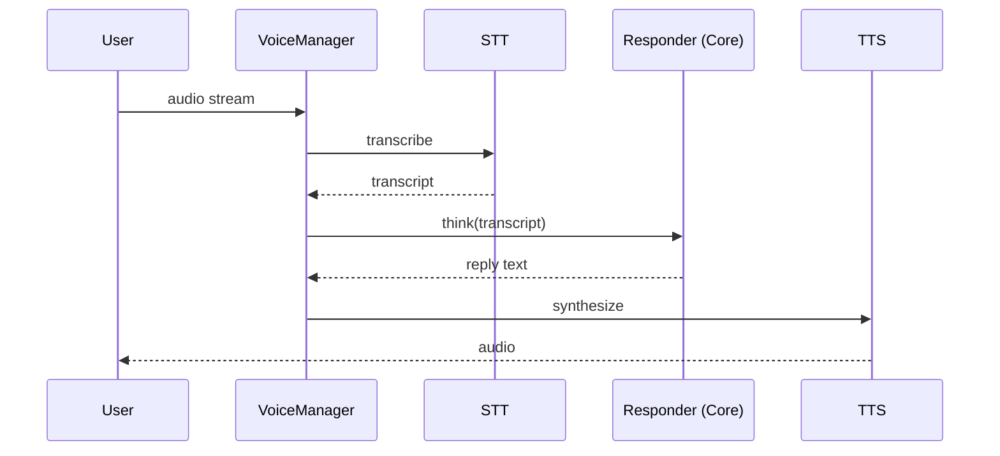

# Voice

Voice turns a spoken utterance into a turn through the Core and back into
speech. It is off by default (`VOICE_ENABLED=false`) and made of swappable STT
and TTS engines with optional fallbacks.

Code: `server/app/voice/`.

## Pipeline

`VoiceManager` owns sessions (`VoiceSession`) and runs one turn end-to-end:

Session states (`VoiceState`): `listening` → `thinking` → `speaking` → `ended`.

Key types: `VoiceTurn` (what was said), `VoiceReply` (pipeline outcome),
`VoiceSession` (a live conversation). Sessions expire after
`VOICE_SESSION_TTL`.

## Engines

### Speech-to-text (`STT_ENGINE`)

`none` \| `faster-whisper` (local) \| `groq` (cloud, OpenAI-compatible
`/audio/transcriptions`).

| Setting | Purpose |
|---|---|
| `STT_MODEL`, `STT_DEVICE`, `STT_COMPUTE_TYPE` | Local model configuration. |
| `STT_LANGUAGE`, `STT_TIMEOUT`, `STT_PARTIAL_RESULTS` | Recognition behaviour. |
| `STT_AUDIO_FORMAT` | `wav` \| `mp3` \| `webm` \| `ogg` \| `flac` \| `m4a`. |
| `GROQ_API_KEY`, `GROQ_BASE_URL`, `GROQ_STT_MODEL` | Groq cloud STT. |

### Text-to-speech (`TTS_ENGINE`)

`none` \| `piper` (local) \| `elevenlabs` (cloud) \| `edge-tts` (local, no key).

| Setting | Purpose |
|---|---|
| `TTS_MODEL_PATH`, `TTS_BINARY_PATH`, `TTS_SAMPLE_RATE` | Piper configuration. |
| `ELEVENLABS_API_KEY`, `…_BASE_URL`, `…_VOICE_ID`, `…_MODEL`, `…_OUTPUT_FORMAT` | ElevenLabs. |
| `EDGE_TTS_VOICE` | edge-tts voice. |

### Fallbacks

`fallback.py` provides `FallbackSTTEngine` and `FallbackTTSEngine`: a primary
engine with a configured fallback behind it. Set `STT_FALLBACK_ENGINE` /
`TTS_FALLBACK_ENGINE`. A primary that fails hands off; the turn is never
silently dropped.

## Barge-in

`VOICE_INTERRUPTION_ENABLED` stops TTS playback when the user starts speaking
again. `VoiceManager` exposes a barge-in signal and cancels the in-flight turn.

## Transport

The client talks to the server over a voice WebSocket
(`app/api/routes/voice.py`, `/ws`). `GET` `/engines` reports available engines.
Control frames manage the session; audio frames carry PCM/encoded audio; event
frames carry transcripts and state changes.

## Wake words

Wake words (`WAKE_WORDS`, default `ultron,hey ultron`) are a **device-side**
concern. A device that hears the wake word (e.g. an ESP32) sends a `wake_word`
device event, which the server maps to the `WAKE_DETECTED` core event. The
server does not itself run wake-word detection.

## Configuration

See [`configuration.md`](configuration.md) for every `VOICE_*`, `STT_*`, `TTS_*`,
`GROQ_*`, `ELEVENLABS_*` and `EDGE_TTS_*` variable.

## Hard rules

1. Voice is off by default; enabling it is explicit.
2. A provider that is unavailable degrades to its fallback, and if there is none
   the failure is reported — never faked with silence-as-success.
3. Voice routes through the Core like any other input; it does not bypass
   permissions or the event bus.
